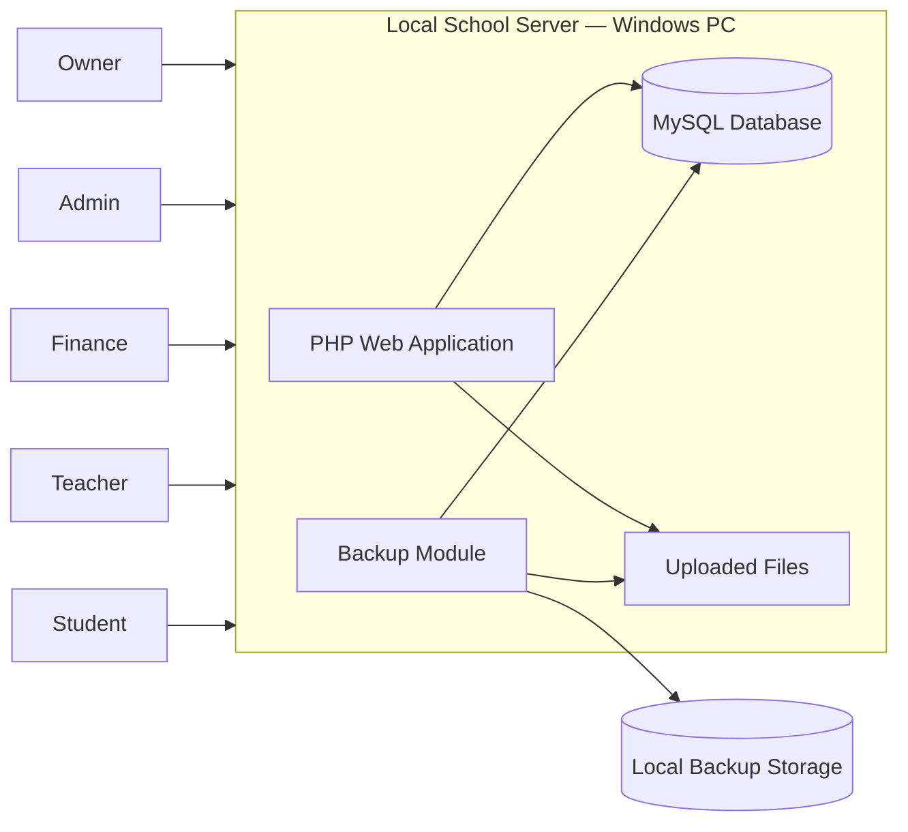

# 🎓 ERP-SNH — Offline-First School Management System

> A modular, offline-first school management platform built for schools in Afghanistan — designed to run on low-spec Windows computers, with no internet required.


---

## 📖 Overview

ERP-SNH is a school management system developed by **Shams Technology Team**. It helps school administrations manage daily operations — students, teachers, fees, salaries, expenses, and reports — from a simple, centralized interface that works without an internet connection.

It was designed around one core reality: **many schools in Afghanistan run on older hardware, have limited technical staff, and cannot depend on stable internet.** So the system is built to be simple to use, robust to install, and safe to update.

---

## 🎯 What It Does

| Area | Capabilities |
|---|---|
| 👥 **Students** | Student records and profiles, student panel access |
| 🧑‍🏫 **Teachers** | Teacher records, teacher panel, teacher data export |
| 💰 **Finance** | Fee management, salary records, expense tracking |
| 🛡️ **Administration** | Role-based access for admin, owner, finance and teacher users |
| 🗄️ **Backup & Restore** | Scheduled or manual backups of the database and uploaded files; restore is restricted to the owner role |
| 📴 **Offline Operation** | Runs entirely on a local machine — no internet required for daily use |

> The owner role has full oversight of the system; the admin enters and manages day-to-day data.

---

## 🏫 Who It's For

- **Schools** (primary through secondary)
- **Courses, tuition and coaching centres** — subject- and timetable-based instead of class- and grade-based
- **Academies and training institutes**

---

## ✨ Design Principles

- **Offline-first** — every feature is designed to work without internet.
- **Low-spec friendly** — runs on older Windows machines.
- **Simple for non-technical users** — minimal clicks, clear forms, no command line.
- **Safe updates** — releases are designed to preserve existing school data.
- **Extensible** — new features can be added, changed, or removed without losing a school's data.

---

## 🧱 Tech Stack

| Layer | Technology |
|---|---|
| Language | PHP |
| Database | MySQL / MariaDB |
| Web server (local) | Apache (bundled through XAMPP for development) |
| Email | PHPMailer |
| Frontend | HTML, CSS, JavaScript |
| Target OS | Windows 7 – Windows 11 |
| Packaging | Windows setup installer (`.exe`) |

---

## 🏗️ Architecture



**Panels:** Owner · Admin · Finance · Teacher · Student — each with its own permissions and views.

---

## 🔐 Security & Data Safety

- Role-based access control across all panels
- Restore operations limited to the owner role
- Backups include both database and uploaded files
- Local-only data storage by default
- Password-recovery by email has been intentionally removed, since the system is designed to run offline

---

## 🚀 Getting Started

> Setup is intended to be done through the official Windows installer. The steps below are for developers working on the source.

**Requirements (development)**

- PHP 8.x (or the version used by the project)
- MySQL / MariaDB
- Apache web server (XAMPP is supported for local development)

**Basic steps**

```bash
# 1. Clone the repository
git clone https://github.com/ERP-SNH/ERP.git

# 2. Move the project into your web root (e.g. XAMPP htdocs)

# 3. Create a MySQL database and import the provided schema

# 4. Configure database connection settings in the project config file

# 5. Open the app in your browser
http://localhost/<project-folder>
```

> ⚠️ Never commit database credentials or secrets. Use local configuration files that are excluded from version control.

---

## 🗺️ Roadmap

- [x] Core school management (students, teachers, finance)
- [x] Role-based panels (owner, admin, finance, teacher, student)
- [x] Backup and restore with scheduling
- [x] Offline-first operation
- [ ] Multilingual interface (English · Dari · Pashto)
- [ ] Right-to-left (RTL) layout support
- [ ] Jalali (Shamsi) calendar support
- [ ] Attendance and timetable modules
- [ ] Course and academy mode (subjects and timings)
- [ ] Reports and printable documents
- [ ] Unified single-file installer for all Windows versions

---

## 🤝 Contributing

Contributions are welcome through pull requests:

1. Fork or branch from `main`
2. Create a focused feature branch: `git checkout -b feature/short-description`
3. Commit with clear messages
4. Open a pull request with a description of what changed and how it was tested

---

## 🏢 About the Team

Developed by **Shams Technology Team**, Kabul, Afghanistan — building practical software for education, operations, and public-sector organizations.

- 👤 **Lead:** Shams Haqyar — Technology & AI Team Lead

---

## 📄 License

This project is proprietary software. All rights reserved by Shams Technology Team.
Contact the team for licensing or deployment inquiries.

---

<p align="center">
  Built with care in Afghanistan 🇦🇫
</p>
